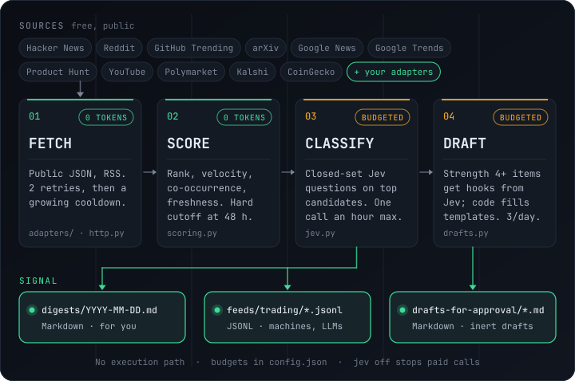

<div align="center">


<br>

**An always-on research watcher that surfaces fresh, rising signals from public sources — and leaves the decision to you.**

[](LICENSE)
[](https://www.python.org/)
[](#requirements)
[](https://github.com/sebby26-cyber/trend-watcher/actions/workflows/tests.yml)
[](#the-output-is-a-signal)
[](#roadmap)

</div>

---

## Contents

- [What it is](#what-it-is)
- [The output is a signal](#the-output-is-a-signal)
- [Features](#features)
- [How it works](#how-it-works)
  - [Token discipline](#token-discipline)
  - [Optional lanes](#optional-lanes)
- [Quick start](#quick-start)
- [Usage](#usage)
  - [Everyday commands](#everyday-commands)
  - [Run options](#run-options)
  - [Domains](#domains)
  - [Alert packs](#alert-packs)
  - [Source adapters](#source-adapters)
  - [SEC EDGAR 8-K engine](#sec-edgar-8-k-engine)
  - [Maintenance](#maintenance)
- [Configuration](#configuration)
- [Project structure](#project-structure)
- [Tests](#tests)
- [Brand](#brand)
- [Roadmap](#roadmap)
- [Contributing](#contributing)
- [Security](#security)
- [Disclaimer](#disclaimer)
- [License](#license)

## What it is

Trend Watch polls public feeds — Hacker News, Reddit, GitHub Trending, Google News,
arXiv, Product Hunt, YouTube, Polymarket, Kalshi, CoinGecko, Google Trends and more —
on a schedule. Every observation lands in a local SQLite database, and items are scored
**locally and for free** on platform rank, velocity, cross-platform co-occurrence and
freshness.

Only the strongest candidates go on to the [TypeSafe](https://typesafe.ai) **Jev**
model, which answers typed, closed-set questions about them — domain, lane, reason,
strength, direction — under a strict daily budget.

What you get back is a signal: a daily Markdown digest, a machine-readable JSONL feed,
and optional template drafts to review.

> [!NOTE]
> **Early is the whole point.** The scoring is tuned for items that are *young and
> accelerating*, not items that are already big. Anything past a hard age limit can
> never become a candidate.

## The output is a signal

Trend Watch **emits a signal and stops.** It has no execution path — nothing in the
codebase connects a result to an action. The signal just comes out in two shapes,
for two kinds of reader:

| Output | Shape | Written for |
|---|---|---|
| `digests/YYYY-MM-DD.md` | Markdown — what's rising, why, how fast | **You.** Read it and decide. |
| `feeds/trading/YYYY-MM-DD.jsonl` | One JSON object per item: score, velocity, age, platforms, assets, direction, strength, confidence | **A machine.** A downstream consumer — your own script, pipeline or LLM agent — parses it. |
| `drafts-for-approval/YYYY-MM-DD.md` | Template post drafts, each headed `DRAFT — NOT POSTED — needs owner approval` | **You.** Text sitting in a file until you move it. |

The JSONL feed is the machine-facing half of the signal: structured observations meant
to be *read by a consumer you write*, not recommendations meant to be executed. It is
machine-readable **and unwired** — Trend Watch writes it and never looks at it again.

The only component that can touch the outside world is an **alert pack**, and only if
you build it that way: packs write a short Markdown nudge into a local outbox, and run
a command solely when you set `nudge.command` in a pack you wrote yourself. The
bundled example sets it to `[]`, so it runs nothing. No packs ship enabled, and none
are required.

> [!IMPORTANT]
> Trend Watch never posts, never places an order, and never messages anyone on its own.
> Every draft is inert text; the research feed has no consumer; publishing hooks are
> documented stubs the pipeline never calls.

## Features

- **Zero dependencies.** Python 3.9+ standard library only. No `pip install`, no build step.
- **Token-frugal by design.** Fetching and scoring cost nothing. Paid Jev calls sit behind per-day call and token budgets and switch off with one command.
- **Prompt-injection aware.** Item text goes only into the model's `state`, never into its instructions. Every answer is a typed Choice or Score, so the model writes no free-form prose.
- **Plug-and-play domains.** One small JSON file per topic sets keywords, exclusions, sources, lanes, tickers, thresholds and drafting. Add or retire topics without touching code.
- **Drop-in adapters.** Add a source in about ten lines of Python in your config directory.
- **Resilient.** One failing source or malformed domain file never fails a run. Sources get exponential retries and growing cooldowns, and a state lock prevents overlapping runs.
- **Scheduler included.** `setup` installs a macOS LaunchAgent or a Linux crontab line that runs twice an hour, plus `enable`, `disable` and `status`.
- **No deletes.** Retiring a domain moves its file to `domains/archive/`. Delivered outputs move to `<state>/outbox-delivered/`.
- **Bring-your-own alert packs.** Evaluate a pack you keep outside the repo and leave nudges for review.
- **SEC EDGAR 8-K shadow engine.** Immutable observations, versioned amendments, an audit trail with acknowledgements, a readiness gate and an offline fixture replay.

## How it works

<div align="center">

</div>

Trend Watch is a short pipeline that runs on every tick. The first two stages cost
nothing. The last two spend tokens, and only inside a daily budget.

| # | Stage | What happens | Cost | Code |
|---|---|---|---|---|
| 1 | **Fetch** | Adapters pull public JSON or RSS with your User-Agent, a 15 s timeout and up to 2 exponential retries on 429 and 5xx. A failing source gets a growing cooldown and never fails the run. | Free | [`adapters/`](trend_watch/adapters), [`http.py`](trend_watch/http.py) |
| 2 | **Score** | URLs and titles are normalized and de-duplicated. Each item scores 0 to 1 from platform rank percentile (0.35), velocity (0.30), cross-platform co-occurrence (0.15) and freshness (0.20). Past 6 h the score decays; past 48 h an item can never become a candidate. A candidate needs 0.55 or more, and is never sent twice. | Free | [`scoring.py`](trend_watch/scoring.py), [`state.py`](trend_watch/state.py) |
| 3 | **Classify** | Up to 15 candidates go to Jev in one batched request of typed questions: domain, lane, strength, reason, angle and action. Every answer comes from a closed set, and item text enters only as `state`, never as instructions. Answers below 0.5 confidence are marked `?`. | Budgeted | [`jev.py`](trend_watch/jev.py) |
| 4 | **Draft** | Items with strength 4 or higher in a `content` lane (at most 3 a day) get hooks and tones picked by Jev. Code fills editable templates for X, Threads, LinkedIn and blog posts. | Budgeted | [`drafts.py`](trend_watch/drafts.py) |

Scoring prefers items that are young and accelerating, because early is the whole
point. With no key, or with `--no-llm`, stages 3 and 4 are skipped and you still get
a scored, unclassified digest.

### Token discipline

Paid calls are the only thing that costs money, so every one passes through gates:

- **No candidates, no call.** A tick with nothing to classify sends nothing.
- **One classification an hour.** Jev is skipped if the last call was under `llm.min_interval_s` (3600 s) ago; candidates wait for the next eligible tick.
- **Daily caps.** 30 calls and 400,000 input tokens per UTC day. At the cap the run falls back to an unclassified digest.
- **Nothing is sent twice.** Results are cached by item hash, and an item is a candidate only once.
- **One switch.** `trend-watch jev off` stops every paid call while fetching and scoring carry on.

### Optional lanes

Two separate lanes read the same local state. Neither is required.

| Lane | What it does | Run it | Details |
|---|---|---|---|
| **Alert packs** | A nudge-only lane you write and keep outside the repo. It reads `state.db` read-only, clusters fresh stories and writes a short Markdown nudge to a local outbox only when a story clears a strict bar. | `trend-watch pack <name> run` | [Alert packs](#alert-packs) |
| **SEC EDGAR 8-K engine** | A separate shadow engine: ingest the 8-K Atom feed, match filings to your watchlist by CIK, then apply deterministic item rules that classify each event `REVIEW`, `IGNORE` or `INCOMPLETE`. Off by default. | `trend-watch tick` | [SEC EDGAR 8-K engine](#sec-edgar-8-k-engine) |

## Quick start

### Requirements

Python 3.9 or newer on macOS or Linux. Nothing else. A
[TypeSafe](https://typesafe.ai) API key is optional — without one, runs are
unclassified but everything else works.

### Install

```sh
git clone https://github.com/sebby26-cyber/trend-watcher.git
cd trend-watcher

# Optional: choose where settings, data and outputs live.
# Defaults: config -> ~/.config/trend-watch, data -> ~/.local/share/trend-watch
export TW_CONFIG_DIR="$HOME/.config/trend-watch"
export TW_STATE_DIR="$HOME/.local/share/trend-watch"
export TW_OUT_DIR="$HOME/trend-watch-output"

# Install the `trend-watch` command and the twice-hourly schedule
bin/trend-watch setup
```

`setup` copies the seed config and domains into your config directory. It symlinks a
`trend-watch` command into `/opt/homebrew/bin` or `/usr/local/bin` when either is on
your `PATH` and writable, and into `~/.local/bin` otherwise. It writes the scheduler
entry — which runs at `:07` and `:37` every hour — with your resolved directories
pinned in it (`TREND_WATCH_PACKS_DIR` and `XDG_CONFIG_HOME` are forwarded when set).

On macOS that entry is `~/Library/LaunchAgents/io.github.trend-watch.plist` (set
`TREND_WATCH_LABEL` to use another label); on Linux it is a user crontab line ending in
`# trend-watch-managed`. Re-run `setup` any time. To install everything without turning
the schedule on, use `setup --no-enable`.

### Add a key (optional)

```sh
export TYPESAFE_API_KEY="your-key-here"
```

On macOS you can use the Keychain instead:

```sh
security add-generic-password -s typesafe-api-key -a "$USER" -w "your-key-here"
```

If no key is found, every run behaves as `--no-llm` and the report says so.

### First run

Start with a dry run — it fetches and scores, writes no outputs and makes no Jev calls:

```sh
trend-watch run --domain ai-tech --dry-run
```

Then a real run, and check the result:

```sh
trend-watch run
trend-watch status
```

> [!TIP]
> Not using the scheduler? Every command also works straight from the checkout as
> `bin/trend-watch …` or `python3 bin/trend-watch …`.

## Usage

### Everyday commands

| Command | What it does |
|---|---|
| `trend-watch status` | Whether the schedule and Jev are on, the last run, today's budget, where outputs are |
| `trend-watch run` | Run one tick now |
| `trend-watch jev off` / `jev on` / `jev` | Stop, resume or show paid Jev calls; everything else keeps running |
| `trend-watch disable` / `enable` | Stop or restart the scheduled job |
| `trend-watch budget` | Today's Jev calls and tokens against the limits |
| `trend-watch flush` | Move outputs queued in the outbox into the outputs folder |
| `trend-watch decay` | Preview eligible state files; add `--apply` to remove them |
| `trend-watch init` | Create any missing config from the seeds; never overwrites your edits |
| `trend-watch pack list` | List the alert packs found on the pack search path |

### Run options

```sh
trend-watch run --domain ai-tech --dry-run      # fetch and score one domain, print a report, write nothing
trend-watch run --dry-run --verbose             # also dump every scored item as JSONL
trend-watch run --no-llm                        # unclassified digest, no Jev calls
trend-watch run --no-drafts                     # classify but skip drafting
trend-watch run --max-candidates 5              # cap the candidates sent to Jev
```

A dry run still records fetch and score history in SQLite, so later runs can measure
velocity. It writes no digest, drafts, feed or outbox, and never calls Jev. Source rate
limits still apply, so a source fetched moments ago may be skipped.

A dry run prints its report on stdout; a normal run prints the same report on stderr.
Example dry-run report (numbers illustrative):

```text
source hackernews: ok | items=60 | errors=0
source reddit: ok | items=75 | errors=0
source github_trending: ok | items=25 | errors=0

Candidate counts by domain x platform:
domain | github_trending | hackernews | reddit
ai-tech | 2 | 4 | 3

Top candidates:
rank | score | domain | platforms | age h | title
1 | 0.812 | ai-tech | hackernews,reddit | 1.4 | Open-weights model tops coding benchmark
2 | 0.744 | ai-tech | github_trending | 3.0 | New agent framework passes 10k stars
unclassified (no-llm: dry-run)
trend-watch: 160 fetched, 3/3 sources ok, 9 candidates, jev=0 (0 tok), drafts=0
```

Every run ends with a single `trend-watch: …` summary line on stdout. `status` reads the
last result back:

```text
Scheduler: on (runs at :07 and :37 every hour; mode: direct)
Jev: on
Last run: Tue 13 Oct 2026, 14:37 - ok - trend-watch: 412 fetched, 11/12 sources ok, 7 candidates, jev=1 (5210 tok), drafts=2
Today's Jev budget: 2026-10-13: calls 3/30, tokens 15630/400000, draft_calls 1 (included in calls)
Outputs: /home/you/trend-watch-output
```

### Domains

```sh
trend-watch domains list                 # active and archived domains
trend-watch domains add my-topic         # creates <config>/domains/my-topic.json
trend-watch domains validate             # exits 1 if any domain or adapter is invalid
trend-watch domains archive my-topic     # moves the file to domains/archive/
trend-watch sources list                 # adapters, their origin, rate floor and last status
```

A domain is one JSON file. Every key is optional and inherits from `config.json`.
Nested maps merge with the defaults; lists replace them:

```json
{
  "name": "my-topic",
  "enabled": true,
  "keywords": ["open source", "llm"],
  "exclude": ["hiring"],
  "sources": {
    "hackernews": {},
    "reddit": {"subreddits": ["LocalLLaMA"]},
    "google_news": {"queries": ["open source AI"]},
    "github_trending": {"topics": ["llm"]},
    "arxiv": {"categories": ["cs.CL"]}
  },
  "lanes": ["content"],
  "tickers": ["NVDA"],
  "thresholds": {"candidate_score": 0.55},
  "drafts": {"platforms": ["x", "linkedin", "blog"], "voice": "plain-spoken operator, no hype"}
}
```

Lanes are `content`, `trading` or both. Unclassified candidates reach the JSONL feed
only for domains with a `trading` lane. The seed set includes `ai-tech`,
`business-startups`, `crypto`, `culture-viral` and `markets-trading`.

Every field a domain may contain — all optional, inheriting from `config.json`, with
any other key rejected:

| Field | Type | Rules |
|---|---|---|
| `name` | string | Lowercase slug (`[a-z0-9][a-z0-9_-]*`), unique, not `none`. Defaults to the file name |
| `enabled` | bool | Disabled domains still appear in `domains list` |
| `keywords` | list of strings | Matched on word boundaries |
| `exclude` | list of strings | Phrases that veto a match |
| `sources` | object | Keys must be registered adapters (see `sources list`); values are parameter objects |
| `lanes` | list | `content` and/or `trading` |
| `tickers` | list of strings | Extra asset symbols to recognize |
| `thresholds.candidate_score` | number | Between 0 and 1 |
| `freshness` | object | `max_age_h`, `hard_max_age_h` (≥ `max_age_h`) and `cooccurrence_h` |
| `weights` | object | `rank_pct`, `velocity_pct`, `cooccurrence`, `freshness`, with a positive sum |
| `max_candidates` | integer | Per-domain candidate cap |
| `drafts` | object | `platforms` from `x`, `threads`, `linkedin`, `blog`, plus `voice`, `tones`, `templates`, `max_per_day` |
| `_help` | any | Free-form note the validator ignores |

### Alert packs

Alert packs are optional and pluggable. A pack is a nudge-only lane you write for your
own interests and keep outside the repository. It reads the shared `state.db`
read-only, clusters fresh stories, scores velocity, relevance, source quality, novelty
and audience fit, and writes a short Markdown nudge only when a story clears a strict
bar. It never drafts, posts or trades. No packs are required, and none for specific
people or accounts ship with the project.

A pack is `<dir>/<name>.json`, with its domains beside it in `<dir>/domains/`. Pack
names are lowercase slugs starting with a letter; `list` is reserved. Discovery searches
these directories in order, and the first `<name>.json` found wins:

| Order | Where | Notes |
|---|---|---|
| 1 | `--packs-dir DIR` | Repeatable. Give it before the subcommand (`trend-watch --packs-dir DIR run`) or after `pack` |
| 2 | `TREND_WATCH_PACKS_DIR` | One or more directories separated by `:` (`os.pathsep`) |
| 3 | `packs_dir` in `<config>/config.json` | Same path-list format; empty by default |
| 4 | `$XDG_CONFIG_HOME/trend-watch/packs/` | Defaults to `~/.config/trend-watch/packs/` |
| 5 | `packs/` in the checkout | Gitignored, so local packs are never committed |

The shipped example is [`examples/packs/example.json`](examples/packs/example.json), a
fictional space-industry pack with one domain. Every setting is documented in
[`examples/packs/README.md`](examples/packs/README.md). Copy the pack together with its
`domains/` folder:

```sh
PACKS="${XDG_CONFIG_HOME:-$HOME/.config}/trend-watch/packs"
mkdir -p "$PACKS"
cp examples/packs/example.json "$PACKS/my-pack.json"
cp -R examples/packs/domains "$PACKS/"
trend-watch pack list
trend-watch domains validate
```

Or try the example in place without copying anything:

```sh
trend-watch --packs-dir examples/packs pack list
trend-watch --packs-dir examples/packs run --no-llm --no-drafts
```

A pack's domains resolve from `<dir>/domains/<domain>.json` first, then from the
repository's `seed/domains/`. The domains of enabled packs join the normal collector on
`run`, while your own edits in `<config>/domains/` and archived domains keep precedence.
A file at `<config>/<name>.json` deep-merges over the pack (nested maps merge, lists
replace), so you can tune a pack without editing it.

Evaluate a pack after a collector run, since it needs the shared `state.db`:

```sh
trend-watch pack my-pack run --dry-run          # score and print the top stories; no nudge, nothing recorded
trend-watch pack my-pack run --dry-run --json   # the same evaluation as JSON
trend-watch pack my-pack run                    # live evaluation; writes a nudge if a story clears the bar
trend-watch pack my-pack run --test-nudge       # force one labelled test nudge from a real story
trend-watch pack my-pack report --hours 24      # Markdown summary of recent evaluations and nudges
trend-watch pack my-pack harvest                # read reply verdicts when tuning is enabled; otherwise a no-op
```

`report` covers the last 24 hours unless you pass `--hours`. Pack state lives in
`<state>/<name>/`: `<name>.db`, `outbox/`, `sent/`, `failed/` and day-named
`log/*.jsonl` files. With `"nudge": {"command": []}`, as in the example, nudges stay in
the pack's `outbox/`. If you set `nudge.command` to an argv list, it runs without a
shell and receives `{marker}`, `{action}` and `{file}` substitutions. The scheduler does
not run packs, so call `trend-watch pack <name> run` from your own wrapper (see
`TREND_WATCH_WRAPPER` under [Configuration](#configuration)) or cron entry after each
collector run.

### Source adapters

Put trusted Python in `<config>/adapters/local_feed.py`:

```python
NAME = "local_feed"
MIN_INTERVAL_S = 900
NEEDS_KEY = False

def fetch(params: dict, ctx) -> list[dict]:
    rows = ctx.get_json(params["url"])
    return [{"title": r["title"], "url": r["url"],
             "score": r.get("score", 0), "published": r.get("published"),
             "snippet": r.get("summary", "")} for r in rows]
```

Reference it from a domain with `"sources": {"local_feed": {"url": "https://…"}}`.
Each returned item needs a non-empty `title` and `url`. Optional fields are a numeric
`score`, a positive integer `rank`, `published` (epoch or ISO), `snippet`, an `extra`
dict and `domain_hint`. `ctx.get_json` and `ctx.get_text` apply the shared HTTP policy,
and `ctx.collect(origins, callback)` keeps the origins that succeed when others fail.

### SEC EDGAR 8-K engine

A separate shadow engine ingests the SEC EDGAR 8-K Atom feed, matches filings against
your watchlist by CIK, and applies deterministic 8-K item rules that classify each event
as `REVIEW`, `IGNORE` or `INCOMPLETE`.

It is **disabled by default** and refuses to fetch live data until
`intake.sec_edgar.user_agent` contains a real contact email, as SEC fair access
requires. To enable it, edit `<config>/config.json`:

```json
"intake": {
  "sec_edgar": {
    "enabled": true,
    "user_agent": "trend-watch/0.1.0 research you@example.com"
  }
}
```

Then add a watchlist and run the stages:

```sh
# Copy the sample into your config directory (the "Settings:" path setup printed), then edit it; CIK is decisive
cp fixtures/edgar-8k/watchlist.json "${TW_CONFIG_DIR:-${XDG_CONFIG_HOME:-$HOME/.config}/trend-watch}/watchlist.json"

trend-watch tick                 # ingest -> resolve -> annotate -> consume -> render, under one lock
trend-watch records              # list active records (read-only)
trend-watch ack <record_uid> --verdict correct --note "checked"
trend-watch replay               # offline fixture replay: no network, no live Jev
trend-watch readiness            # go-live gate (read-only)
trend-watch scan                 # digit-run tripwire over shadow outputs and feeds
```

Records and the Markdown report are written to `<state>/shadow/investment/`. No
schedule is installed for `tick`, so run it yourself or add your own cron entry.

Sample `replay` tail:

```text
matched 51/51; decision precision 1.000; REVIEW precision 1.000
exceptions: 0
tripwire hits over replay outputs: 0
REPLAY PASSED
```

### Maintenance

```sh
trend-watch migrate              # apply pending forward-only state.db migrations (backs up first)
trend-watch backup [--dest DIR]  # online backup of state.db (default <state>/backups)
trend-watch restore <file>       # archive the current state.db, then restore a backup
trend-watch decay                # preview eligible files and the space they would free
trend-watch decay --apply        # remove eligible entries and log the results
```

File retention defaults to [`seed/decay.json`](seed/decay.json): old run logs, copies of
outputs already delivered by `flush`, and database backups. Rules use entry modification
times and keep the newest matching entries as configured. `decay` is a dry run unless
you pass `--apply`; removals and a summary are appended to `<state>/logs/decay.jsonl`.
Protected paths and symlinks are skipped.

If `<config>/decay.json` exists, it replaces the seed policy entirely. Copy the seed
there to customize it or add rules for pack logs, and list the pack's database and
outbox/sent/failed directories under `never`. Database rows are pruned separately
through the `retention` block of `config.json` during normal `run` executions.

## Configuration

Settings are JSON and are re-read on every run. Override only what you need in
`<config>/config.json`; [`seed/config.json`](seed/config.json) holds every default.
Unknown keys are rejected.

### Directories and environment

| Option | Env var | Default | Description |
|---|---|---|---|
| Config directory | `TW_CONFIG_DIR` | `~/.config/trend-watch` | `config.json`, `domains/`, `domains/archive/`, `adapters/`, `watchlist.json`, pack overrides |
| State directory | `TW_STATE_DIR` | `~/.local/share/trend-watch` | `state.db`, `last-run.json`, `logs/`, `outbox/`, `feeds/trading/`, `shadow/`, `backups/`, one folder per pack |
| Output directory | `TW_OUT_DIR` | `<state>/out` | `digests/` and `drafts-for-approval/` Markdown files |
| Single home | `TREND_WATCH_HOME` | unset | One root for everything: `<home>/config`, `<home>` as state, `<home>/out` |
| Pack search path | `TREND_WATCH_PACKS_DIR` | unset | Extra pack directories, separated by `:`; see [Alert packs](#alert-packs) |
| Scheduler label | `TREND_WATCH_LABEL` | `io.github.trend-watch` | launchd label and plist name used by `setup`, `enable`, `disable`, `status` |
| Scheduler wrapper | `TREND_WATCH_WRAPPER` | unset | Executable the schedule runs instead of `bin/trend-watch run`; `status` then reports `mode: custom wrapper` |
| API key | `TYPESAFE_API_KEY` | none | TypeSafe API key; if unset, the Keychain is checked next |

Each directory resolves on its own, in this order:

- **Config:** `TW_CONFIG_DIR`, then `$TREND_WATCH_HOME/config`, then `$XDG_CONFIG_HOME/trend-watch`, then `~/.config/trend-watch`.
- **State:** `TW_STATE_DIR`, then `$TREND_WATCH_HOME`, then `$XDG_DATA_HOME/trend-watch`, then `~/.local/share/trend-watch`.
- **Output:** `TW_OUT_DIR`, then `$TREND_WATCH_HOME/out`, then `out/` inside the resolved state directory.

So with `TREND_WATCH_HOME` set, a `TW_*` variable still wins for its own directory, and
output stays at `$TREND_WATCH_HOME/out` even if `TW_STATE_DIR` points elsewhere. `setup`
prints the directories it resolved and pins them in the scheduler entry.

### Settings

| Setting | Default | Description |
|---|---|---|
| `packs_dir` | `""` | Extra pack directories (same `:`-separated format), searched after `TREND_WATCH_PACKS_DIR` |
| `llm.keychain_service` | `typesafe-api-key` | macOS Keychain service the key is read from |
| `llm.enabled` | `true` | Master switch for Jev calls (`trend-watch jev on/off` changes it) |
| `llm.model` | `jev-1.13.0` | Pinned Jev model |
| `llm.endpoint` | `https://api.typesafe.ai/v1/systemone` | TypeSafe endpoint |
| `llm.min_confidence` | `0.5` | Answers below this are shown with `?` |
| `budget.max_calls_per_day` | `30` | Daily Jev call cap (UTC day), including drafts and retries |
| `budget.max_input_tokens_per_day` | `400000` | Daily input-token cap |
| `max_candidates` | `15` | Items sent per classification request |
| `thresholds.candidate_score` | `0.55` | Minimum score (0–1) for an item to become a candidate |
| `freshness.max_age_h` / `hard_max_age_h` | `6` / `48` | Freshness window and hard age cutoff, in hours |
| `weights.*` | `0.35 / 0.30 / 0.15 / 0.20` | Weights for rank, velocity, co-occurrence and freshness (normalized) |
| `drafts.max_per_day` | `3` | Daily draft cap |
| `drafts.platforms` | `["x", "linkedin", "blog"]` | Any of `x`, `threads`, `linkedin`, `blog` |
| `http.user_agent` | generic string | User-Agent sent to sources; set your own |
| `http.timeout_s` / `retries` | `15` / `2` | Request timeout and retry count |
| `intake.sec_edgar.enabled` | `false` | Turns on the EDGAR 8-K intake |
| `intake.sec_edgar.user_agent` | placeholder | Must include your contact email |
| `intake.sec_edgar.request_interval_s` | `0.2` | Seconds between SEC requests; minimum `0.1` (10 req/s) |
| `investment.watchlist_path` | `watchlist.json` | Watchlist path, relative to the config directory |
| `retention.days` | `30` | Retention for state tables |
| `hooks.notify_enabled` / `publish_enabled` | `false` | Stub hooks only. `publish` is never called |

> [!NOTE]
> UTC defines output file names and budget days; the schedule uses local wall-clock
> time. On macOS, if privacy protection blocks a write to the output directory, the file
> is queued in `<state>/outbox/`. `trend-watch flush` delivers it later.

## Project structure

```text
trend-watcher/
├── .github/
│   ├── workflows/tests.yml      # CI: tests on Python 3.9-3.13, Linux and macOS
│   └── dependabot.yml           # keeps the pinned Actions current
├── assets/
│   ├── banner.svg               # brand hero
│   ├── how-it-works.svg         # pipeline diagram
│   ├── logo.svg                 # brand mark
│   └── social-preview.png       # 1280x640 link-preview card
├── bin/
│   └── trend-watch              # CLI launcher (no install needed)
├── trend_watch/
│   ├── cli.py                   # argparse entry point and subcommands
│   ├── config.py                # path resolution, config merge and validation, domains
│   ├── decay.py                 # state file retention (dry-run unless --apply)
│   ├── setup.py                 # setup, launchd/cron scheduler, status
│   ├── pipeline.py              # fetch -> score -> classify -> draft -> deliver
│   ├── packs.py                 # optional nudge-only alert packs
│   ├── registry.py              # adapter discovery (built-in and drop-in)
│   ├── http.py                  # shared HTTP policy, retries, cooldowns
│   ├── scoring.py               # normalization, velocity, composite score
│   ├── jev.py                   # TypeSafe Jev client, budgets, typed parsing
│   ├── drafts.py                # template drafter
│   ├── outputs.py               # digests, outbox and flush
│   ├── state.py, migrations.py, backup.py, lock.py
│   ├── engine.py                # shadow engine stages (tick/ingest/resolve/…)
│   ├── intake/sec_edgar.py      # SEC EDGAR 8-K Atom intake
│   ├── consumers/investment.py  # deterministic 8-K item rules
│   ├── observations.py, annotator.py, watchlist.py, ids.py
│   ├── replay.py, readiness.py, tripwire.py, records.py
│   ├── safexml.py, serialize.py
│   ├── adapters/                # hackernews, reddit, arxiv, github_trending, …
│   └── hooks/                   # notify / publish / external drafter stubs
├── seed/
│   ├── config.json              # every default setting
│   ├── decay.json               # default retention policy
│   └── domains/*.json           # starter domains copied by init/setup
├── examples/packs/              # pack schema, example pack and its domain
├── fixtures/edgar-8k/           # offline 8-K fixtures and a sample watchlist
├── tests/                       # test suite (conftest.py isolates pack discovery)
├── docs/
│   ├── BRAND.md                 # brand guide
│   ├── DESIGN-SPEC.md           # build spec
│   └── R1-SPEC-DELTAS.md
├── packs/                       # optional local packs (gitignored)
└── LICENSE                      # GNU GPL v3.0
```

## Tests

```sh
python3 -m pytest -q
```

168 tests, no secrets and no network access. They run in temporary directories with
fake adapters, fixture RSS and JSON, and fake Jev HTTP responses, and real HTTP is
blocked. `tests/conftest.py` points pack discovery at an empty directory, so packs you
have installed never leak into a test run.

pytest is the only test dependency; the tool itself needs nothing beyond the standard
library. Most tests are also plain `unittest` cases, so this runs that subset (162 of
them) with no dependencies at all:

```sh
python3 -m unittest discover -s tests
```

To check the 8-K rules end to end offline, run `trend-watch replay`.

CI runs on every push and pull request, on Python 3.9 to 3.13 on Linux and 3.12 on macOS. It runs the standard-library tests with nothing installed, then the full pytest suite, then an offline smoke test of the CLI (`init`, `domains validate`, `replay`). See [`.github/workflows/tests.yml`](.github/workflows/tests.yml).

## Brand

Trend Watch is **instrument-grade, terminal-native and calm**. The mark tells the whole
story in one glance: a flat noise floor spikes into a rising signal, with a radar ping
opening at the peak — *a trend, caught early, and watched.*

<div align="center">

</div>

### Palette — "Signal"

Every color carries a meaning that maps to how the tool behaves.

| Token | Hex | Role |
|---|---|---|
| **Ink** | `#0B0E14` | Base background, the night watch |
| **Slate** | `#141A24` | Panels, code surfaces |
| **Edge** | `#222A38` | Borders, grid lines |
| **Signal** | `#3DDC97` | **Primary.** Fresh signal, safe, surfaced |
| **Pulse** | `#F5A623` | **Secondary.** Rising velocity, "needs review" |
| **Haze** | `#E6EAF2` | Primary text on dark |
| **Mist** | `#AEB7C6` | Secondary text, taglines and diagram body copy |
| **Fog** | `#7D8798` | Muted text, the noise floor |

Green is *observed / safe / surfaced*. Amber is *rising / attention / `REVIEW`*. Grey is
*noise*. That's the same vocabulary the shadow engine and the scoring already use, so
the palette teaches itself.

### Typography

| Use | Typeface | Fallback |
|---|---|---|
| Wordmark, code, UI chrome | **JetBrains Mono** | `ui-monospace, "SF Mono", Menlo, monospace` |
| Body and docs | **Inter** | `system-ui, -apple-system, sans-serif` |

The wordmark is JetBrains Mono Bold with tight tracking, optionally followed by a single
Signal-green cursor block.

### Voice

Plain-spoken operator. No hype — the same voice the tool drafts in by default. Short
declaratives, useful fact first. Avoid "revolutionary", "AI-powered", "game-changing".

- Primary tagline — *Catch the signal before the crowd — then decide for yourself.*
- Short form — *Signal, early. The decision stays yours.*

### Naming

The product is **Trend Watch** (two words). The command is `trend-watch` and the
repository is `trend-watcher` — those keep their hyphens because they are literal
identifiers, not the brand name.

The full guide, including logo clear space and misuse rules, is in
[`docs/BRAND.md`](docs/BRAND.md).

## Roadmap

- **Shadow to production for the 8-K engine.** Production rendering stays off until `trend-watch readiness` passes: 14 shadow days, 20 spot-checks and REVIEW precision of at least 0.8.
- **Key-based adapters.** `x`, `tiktok` and `instagram` are registered stubs that still need an API key or a scraper.
- **External drafter backend.** `drafts.backend: "external"` calls a documented stub (`hooks/drafter_external.py`); no generative backend ships yet.

## Contributing

Contributions are welcome.

1. Fork the repo and create a feature branch.
2. Keep to the house rules: standard library only, Python 3.9 compatible, no secrets in code or config, and no file deletions. Item text must stay out of model instructions.
3. Add or update tests and run `python3 -m pytest -q`. CI runs the same suite on every pull request.
4. Run `trend-watch domains validate` if you touched seeds or adapters.
5. Open a pull request describing the change and its motivation.

By contributing, you agree that your contributions are licensed under the GNU General
Public License v3.0.

## Security

Trend Watch holds no credentials of its own. The TypeSafe key is read from the
environment or the macOS Keychain and is never written to config or logs. Item text from
public sources is treated as untrusted data: it enters the model's `state` only, never
its instructions, and every answer is a closed-set Choice or Score.

Found a vulnerability? Please open a
[security advisory](https://github.com/sebby26-cyber/trend-watcher/security/advisories/new)
rather than a public issue.

## Disclaimer

Trend Watch is a research and monitoring tool. **Nothing it produces is financial,
investment or trading advice.** Classifications, "direction" fields and research feeds
are automated observations that can be wrong, so verify primary sources before acting on
them.

When you enable SEC EDGAR intake, follow the
[SEC's fair access policy](https://www.sec.gov/os/accessing-edgar-data): send a
User-Agent with your contact email and stay at or below 10 requests per second. Trend
Watch enforces a minimum request interval and refuses to fetch with a placeholder
User-Agent. You are still responsible for how you use it. Respect the terms of service
and rate limits of every source you configure.

## License

Released under the [GNU General Public License v3.0](LICENSE).

<div align="center">
<br>
<sub><b>Trend Watch</b> · Signal, early. The decision stays yours.</sub>
</div>
