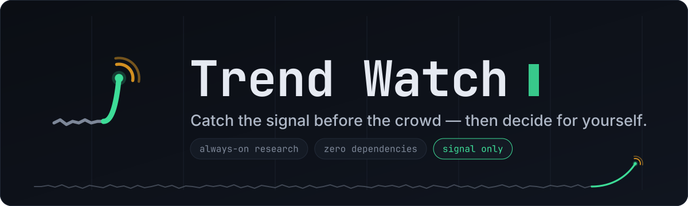
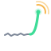

# Brand Guide

*The visual and verbal system for Trend Watch.*

---

Trend Watch has one job: **catch the rising signal before the crowd, then hand the
decision to a human.** The brand exists to make that feeling legible — calm,
instrument-grade, and quietly trustworthy. Nothing flashy. The tool is restrained
by design (it emits a signal and stops, and it spends tokens sparingly), and the brand
should feel the same way.

> **Name:** the product is **Trend Watch** (two words, title case).
> The command is `trend-watch` and the repository is `trend-watcher` — those keep their
> hyphens because they are literal identifiers, not the brand name.

## The idea in one mark

The logo is a story in one glance: a flat **noise floor** that suddenly spikes into a
**rising signal**, with a radar **ping** opening at the peak — *a trend, caught early,
and watched.*

- **Green spike + node** — the signal: fresh, surfaced, safe to look at.
- **Amber ping** — velocity and attention: *this one is rising, review it.*
- **Grey floor** — the noise everything else fades into.

## Color — the "Signal" palette

Dark-native, built for a terminal. Every color carries a meaning that maps to how the
tool actually behaves.

| Token | Hex | Role | Swatch |
|---|---|---|---|
| **Ink** | `#0B0E14` | Base background, the night watch |  |
| **Slate** | `#141A24` | Panels, code surfaces |  |
| **Edge** | `#222A38` | Borders, grid lines |  |
| **Signal** | `#3DDC97` | **Primary.** Fresh signal, safe, surfaced |  |
| **Pulse** | `#F5A623` | **Secondary.** Rising velocity, "needs review" |  |
| **Haze** | `#E6EAF2` | Primary text on dark |  |
| **Mist** | `#AEB7C6` | Secondary text, taglines and diagram body copy |  |
| **Fog** | `#7D8798` | Muted text, the noise floor |  |

**Semantic rule.** Green is *observed / safe / surfaced*. Amber is *rising / attention /
`REVIEW`*. Grey is *noise*. This is the same vocabulary the shadow engine uses
(`REVIEW` / `IGNORE`) and that scoring uses (velocity) — keep it consistent and the UI
teaches itself.

## Typography

A dev tool should look like one. The identity is monospace-forward.

| Use | Typeface | Fallback stack |
|---|---|---|
| Wordmark, code, UI chrome | **JetBrains Mono** | `ui-monospace, "SF Mono", Menlo, monospace` |
| Body & docs | **Inter** | `system-ui, -apple-system, sans-serif` |

Set the wordmark in JetBrains Mono **Bold**, tight tracking. A single **Signal-green
cursor block** may follow the wordmark as a terminal-native flourish — never more than one.

## Voice

Plain-spoken operator. No hype. (It is literally the tool's own default drafting voice.)

- **Say:** "Catch the signal before the crowd." · "It emits a signal and stops." · "Early is the whole point."
- **Avoid:** "revolutionary", "AI-powered", "game-changing", exclamation marks, emoji in body copy.
- Short declaratives. Lead with the useful fact. Let restraint do the talking.

**Taglines**
- Primary — *Catch the signal before the crowd — then decide for yourself.*
- Short — *Signal, early. The decision stays yours.*

## Logo usage

- **Clear space:** keep padding around the mark at least the height of the radar ping.
- **Minimum size:** 20px for the mark; don't shrink the banner below ~480px wide.
- **Do** place the mark on Ink or on white. **Do** use a monochrome version (Fog floor,
  Signal spike) when a single accent is needed.
- **Don't** recolor the rising spike anything but Signal green. **Don't** stretch, rotate,
  add drop shadows, or box the mark in a hard rectangle.

## Assets

| File | What |
|---|---|
| [`assets/banner.svg`](../assets/banner.svg) | Hero banner (README header, social card) |
| [`assets/logo.svg`](../assets/logo.svg) | Standalone mark (icon, favicon source) |
| [`assets/how-it-works.svg`](../assets/how-it-works.svg) | Pipeline diagram (README "How it works") |

All three are SVG with no external font dependencies. Wordmarks and diagram labels are
JetBrains Mono converted to outlines, so they render the same everywhere and on both
GitHub light and dark themes. Each sits on its own dark card, so none depend on the
reader's theme.
